I build Python applications that help people explore data, examine news, and plan what to study next.

[Project workbench](#project-workbench) · [Tools by task](#tools-by-task) · [GitHub activity](https://github.com/Priti02707#contribution-graph)

## Project workbench

Choose a question to see how the project approaches it, then open the demo or inspect the code.

<strong>01 · What influenced this news classification?</strong> — Fake News Detection

**Input** · An English news article.

**What to explore** · See which words or phrases influenced the model, then examine retrieved sources separately when assessing a claim. The model’s prediction reflects patterns in the article text.

**Stack** · Python, FastAPI, Next.js

[Open demo](https://fake-news-detection-priti.vercel.app/) · [Read the code and docs](https://github.com/Priti02707/Fake-News-Detection)

<strong>02 · What should I study next?</strong> — AI Study Planner

**Input** · Exam dates, available study windows, and a list of topics.

**What to explore** · Build a schedule, record practice results, and see how future priorities change as you make progress.

**Stack** · Python, Streamlit, SQLite, PostgreSQL

[Open demo](https://ai-study-planner-lac.vercel.app) · [Read the code and docs](https://github.com/Priti02707/AI--Study-Planner) · 

<strong>03 · What patterns show up in IPL match data?</strong> — IPL Capstone

**Input** · IPL match records covering teams, players, toss decisions, and venues.

**What to explore** · Compare team results, inspect player performance, and see how often toss winners also won the match.

**Stack** · Python, pandas, NumPy, Matplotlib, seaborn

[Explore the capstone](https://github.com/Priti02707/IPL_Capstone-Project)

<strong>04 · How do messy records become analysis-ready?</strong> — Employee Data Cleaning Pipeline

**Input** · Employee records with missing values, duplicates, and inconsistent column formats.

**What to explore** · Follow how the pipeline standardizes names and departments, converts numeric and date fields, and handles missing entries.

**Stack** · Python, pandas, NumPy

[Inspect the pipeline](https://github.com/Priti02707/data-cleaning-pipeline-using-numpy-pandas)

## Tools by task

| Task | Tools |
| --- | --- |
| Prepare and explore data | Python, pandas, NumPy |
| Visualize patterns | Matplotlib, seaborn |
| Build interfaces and APIs | Streamlit, FastAPI, Next.js |
| Store application data | SQLite, PostgreSQL |

## Repository pulse

[Browse all public repositories](https://github.com/Priti02707?tab=repositories)
